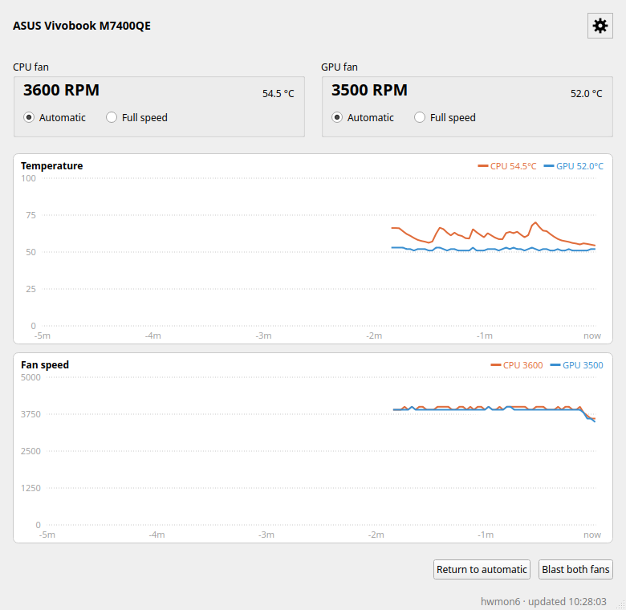
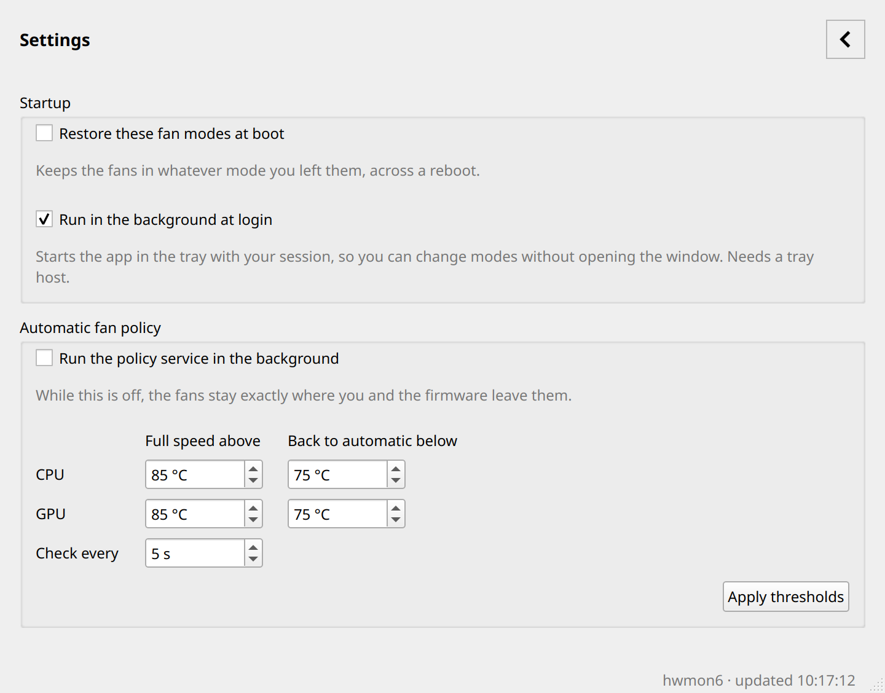

# Vivobook Fan Control

Fan control and monitoring for the **ASUS Vivobook 14X M7400QE / M7400QC** on Linux —
a Qt 6 graphical window and a `fanctl`-style command line, packaged as a `.deb`.



The M7400QE (Ryzen 9 7940HS / RTX 3050) exposes its fans through the kernel's `asus`
hwmon driver, which on this model offers only a **control mode** per fan — firmware
automatic, or forced full speed. This tool reads both fans plus their temperatures and
lets you switch between those two modes from the GUI or the shell.

- **Tested on:** Vivobook 14X M7400QE, Pop!_OS 24.04 (COSMIC, Wayland), kernel 7.2.x
- **Expected to work on:** any Vivobook whose `asus` hwmon device exposes `pwm1_enable`
  / `pwm2_enable` with `cpu_fan` / `gpu_fan` labels — which includes the M7400QC.
  It is not limited to these two models; device discovery happens at runtime.

## Features

| | |
|---|---|
| Live readout | CPU and GPU fan RPM, plus CPU (`k10temp`) and GPU (`amdgpu`) temperatures, refreshed every 2 s |
| Mode control | Switch each fan independently between **Automatic** and **Full speed** |
| History graphs | 5-minute rolling charts for temperature and fan speed, painted with `QPainter` (no Qt Charts dependency) |
| Two pages | The window keeps only what changes; startup options and the fan policy sit behind the gear |
| Tray + background | Close the window and choose tray or quit (rememberable); optionally start with the session as a systemd user service |
| Temperature policy | A root service that forces full speed above a threshold and back to automatic below it, per fan |
| Restore at boot | Optionally re-apply your chosen modes early in the next boot via a systemd unit |
| CLI parity | Every GUI action is also available on the command line, sharing one codebase |
| No sudo rules | Writes go through a polkit-authorized root helper; sysfs stays root-owned |

## Run in the background

Two separate things, both optional:

**Stay in the tray.** Close the window and the app asks whether to minimize to the tray or
quit, with a *Remember my choice* box so you only answer once. Clear that decision any
time with:

```bash
rm ~/.config/vivobook-fan-control/vivobook-fan-control.conf
```

**Start with your session.** On the **Settings** page, tick **Run in the background at
login** and the app enables `vivobook-fan-control.service`, a systemd **user** unit that
launches `vivobook-fan-control --tray` into your graphical session. A user service needs no
administrator rights, so this checkbox never prompts for a password. A lock file keeps a
manual launch from creating a second tray icon; if the app is already running in the
background, starting it again just tells you so.

## Automatic fan policy

On the **Settings** page, tick **Run the policy service in the background** to enable
`vivobook-fan-policy.service`, a root service that watches temperatures and moves each fan
on its own:

- above the **full speed** threshold, the fan is forced to full speed
- below the **back to automatic** threshold, control returns to the firmware
- in between, nothing changes — that gap is the hysteresis that stops flapping

Thresholds live in `/etc/vivobook-fan-control/policy.conf` and are re-read every check, so
applying new values needs no restart. Reading them is unprivileged (the GUI and
`policy show` never prompt); only the root helper writes them.

Because the driver only offers automatic and full speed, this is a two-state policy, not a
fan curve. While the service is on it owns the modes it manages, so a manual switch is
overridden on the next check. The unit runs sandboxed: `ProtectSystem=strict` with
`ReadWritePaths=/sys`, `NoNewPrivileges`, `PrivateTmp` and `ProtectHome`.

## Install

Two downloads, from the
[latest release](https://github.com/WILBOARDS/vivobook-fan-control/releases/latest):

| File | Contains | Pulls in Qt GUI libs? |
|---|---|---|
| `vivobook-fan-control-cli_1.2.0_amd64.deb` | `vivobook-fanctl`, the root helper, the policy daemon, the polkit policy and both system units | **No** - Qt Core only |
| `vivobook-fan-control_1.2.0_amd64.deb` | The Qt 6 window, desktop entry, icon and the login tray unit | Yes (and it depends on the CLI package) |

**Command line only** — good for a minimal or headless install:

```bash
sudo apt install ./vivobook-fan-control-cli_1.2.0_amd64.deb
vivobook-fanctl status
```

**With the graphical window** — install both files together so the package manager can
order the dependency:

```bash
sudo apt install ./vivobook-fan-control-cli_1.2.0_amd64.deb ./vivobook-fan-control_1.2.0_amd64.deb
```

Then launch **Vivobook Fan Control** from your application menu, or run
`vivobook-fan-control` from a terminal. To remove everything:
`sudo apt remove vivobook-fan-control vivobook-fan-control-cli`.

> Use `apt install ./file.deb`, not `dpkg -i`. When upgrading from 1.1.0 — a single
> package that has since been split in two — `dpkg -i` unpacks the files in the order you
> list them and the handover of `/usr/bin/vivobook-fanctl` and `/usr/libexec/…` to the new
> CLI package can fail, leaving `vivobook-fan-control` unpacked but unconfigured. `apt`
> resolves the order first. If you ever land in that state, `sudo dpkg -i
> vivobook-fan-control-cli_*.deb` and then the GUI package fixes it.

## Build from source

```bash
# 1. Build dependencies (Ubuntu 24.04 / Pop!_OS 24.04)
sudo apt install cmake ninja-build g++ qt6-base-dev dpkg-dev

# 2. Clone and build
git clone https://github.com/WILBOARDS/vivobook-fan-control.git
cd vivobook-fan-control
cmake -S . -B build -G Ninja -DCMAKE_BUILD_TYPE=Release
cmake --build build

# 3. Run straight from the build tree (fan changes still need the installed
#    polkit policy, so status works here but mode changes will be refused)
./build/vivobook-fan-control status

# 4. Produce both .deb packages — no debhelper or root required
./scripts/build-deb.sh
#    -> debian/out/vivobook-fan-control-cli_1.2.0_amd64.deb
#    -> debian/out/vivobook-fan-control_1.2.0_amd64.deb

# 5. Install them
sudo apt install ./debian/out/vivobook-fan-control-cli_1.2.0_amd64.deb \
                 ./debian/out/vivobook-fan-control_1.2.0_amd64.deb
```

## Command line

```
vivobook-fanctl status                Show fan modes, RPM and temperatures
vivobook-fanctl cpu auto|full         Set the CPU fan mode
vivobook-fanctl gpu auto|full         Set the GPU fan mode
vivobook-fanctl all-auto              Restore both fans to automatic
vivobook-fanctl all-full              Run both fans at full speed
vivobook-fanctl boot on|off           Re-apply the chosen modes at boot
vivobook-fanctl policy show           Show thresholds and whether the service runs
vivobook-fanctl policy on|off         Run the policy service in the background
vivobook-fanctl policy set k=v [...]  Change thresholds (cpu_full_above, cpu_auto_below,
                                      gpu_full_above, gpu_auto_below, interval)
vivobook-fanctl gui                   Open the graphical window
```

The app also accepts `--tray` to start hidden in the tray, which is what the login service
uses.

Example:

```
$ vivobook-fanctl all-full
cpu fan set to full
gpu fan set to full

$ vivobook-fanctl status
=== ASUS Vivobook Fan Status ===
CPU Fan: 6100 RPM | Full speed
GPU Fan: 2400 RPM | Full speed
CPU Temp: 46.5 C
GPU Temp: 41.0 C

Hardware path: /sys/class/hwmon/hwmon6
Restore at boot: disabled
```

> **Why not `fanctl`?** Pop!_OS ships `/usr/sbin/fanctl` from the `ubuntu-fan` package,
> and `/usr/sbin` usually precedes `/usr/bin` in `PATH`. The command is therefore named
> `vivobook-fanctl` to avoid shadowing it.

## Graphical interface

The main page is what changes: each fan gets a card with RPM, temperature and Automatic /
Full speed buttons, and the two graphs below keep the last five minutes of samples.
Everything you set once lives behind the **gear** in the top-right corner (`Ctrl+,`).

- **Blast both fans** forces both to full speed; **Return to automatic** hands control
  back to the firmware. Use the second one when you are done — full speed is meant for
  quick cooldown or diagnosing a fan, not as a permanent setting.
- **Settings → Startup** holds **Restore these fan modes at boot**, which enables
  `vivobook-fan-restore.service` so it re-applies whatever modes you last chose, and
  **Run in the background at login**.
- **Settings → Automatic fan policy** holds the service switch and the per-fan
  thresholds described above.
- Closing the window asks whether to keep running in the tray or quit. The tray menu
  (when the desktop provides a StatusNotifier host) offers the same actions without
  opening the window.



## How it works

The app itself never writes to sysfs. It is split in three:

```
vivobook-fan-control  ──GUI + CLI, unprivileged, reads /sys/class/hwmon──┐
                                                                        │ pkexec
fancontrol-helper     ──root, validates args, writes pwmN_enable────────┘
        ▲
org.vivobookfancontrol.policy  ──polkit action, auth_admin_keep
```

| Path | Role |
|---|---|
| `/usr/bin/vivobook-fan-control` | GUI and CLI binary |
| `/usr/bin/vivobook-fanctl` | Symlink used for command line invocation |
| `/usr/libexec/vivobook-fan-control/fancontrol-helper` | Root helper: `apply`, `restore`, `boot`, `policy`, `service` |
| `/usr/libexec/vivobook-fan-control/fancontrol-policyd` | Root policy daemon loop |
| `/usr/share/polkit-1/actions/org.vivobookfancontrol.policy` | Authorization rules for the helper |
| `/usr/lib/systemd/system/vivobook-fan-restore.service` | One-shot unit that re-applies modes at boot |
| `/usr/lib/systemd/system/vivobook-fan-policy.service` | The policy daemon |
| `/usr/lib/systemd/user/vivobook-fan-control.service` | Starts the tray app with your session |
| `/var/lib/vivobook-fan-control/modes` | The modes you last chose, e.g. `cpu=auto` |
| `/etc/vivobook-fan-control/policy.conf` | Policy thresholds, world-readable |

The helper discovers the hwmon device itself rather than accepting a path from the
caller, validates every argument against a fixed vocabulary, never spawns a shell, and
reads the value back to confirm the firmware accepted it.

`pwmN_enable` values on this machine: `0` = full speed, `2` = automatic. The driver
exposes no `pwmN` value file, so classic manual PWM curves (`1`) are not available —
firmware control is the ceiling here, not a limitation of this tool.

## Troubleshooting

**"ASUS fan controller not found under /sys/class/hwmon"**
The platform driver is not loaded. Check `lsmod | grep asus` and confirm a chip named
`asus` exists: `for d in /sys/class/hwmon/hwmon*; do echo "$d $(cat $d/name)"; done`.

**The authentication dialog is rejected, or the app hangs on "Waiting for authentication"**
This package asks for `auth_admin` (cached for the session). On COSMIC, an action that
requests `auth_self` can fail to authenticate even with the correct password, so the
policy deliberately does not use it. Make sure you are in the `sudo` group (`id -nG`).

**Fans do not change at all in full speed**
The CPU fan responds on the M7400QE (roughly 2500 → 6100 RPM). The GPU fan has been
observed to stay near its idle speed even with `pwm2_enable=0`, because the firmware
keeps regulating it. The mode is still written and reported correctly.

**Starting the app says it is already running in the background**
The login service instance holds `/tmp/vivobook-fan-control.lock`. Use its tray icon, or
stop it with `systemctl --user disable --now vivobook-fan-control.service`.

**A manual switch gets undone a few seconds later**
The policy service is enabled and is re-asserting its thresholds. Turn it off, or widen the
hysteresis band so the current temperature falls between the two values.

**No tray icon appears**
The desktop must provide a StatusNotifier host (`org.kde.StatusNotifierWatcher`). COSMIC,
KDE and GNOME-with-extension do; on a desktop without one the status bar reports
`tray unavailable`, closing the window simply quits, and the login service shows the window
instead of hiding it.

**You want no password prompt at all**
You can make the sysfs nodes group-writable with a udev rule instead, but that lets any
local process spin your fans. If you go that route, keep the helper as the only writer
and give the rule a dedicated group rather than `a+w`.

## Limitations

- Full speed is a mode switch, not a speed curve: the driver exposes no per-fan PWM value.
- RPM reads can briefly report `0` immediately after a mode change while the fan ramps.
- The tray icon needs a StatusNotifier host; on desktops without one the window works
  normally and the status bar says the tray is unavailable.

## License

MIT — see [LICENSE](LICENSE).
